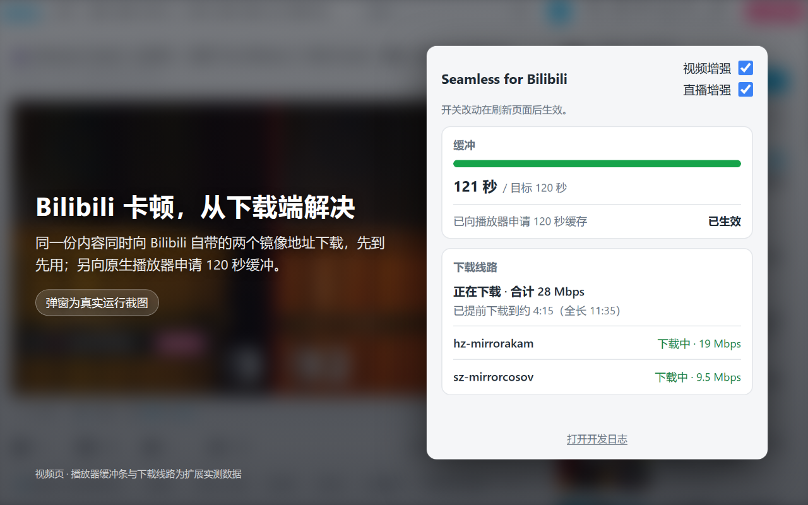
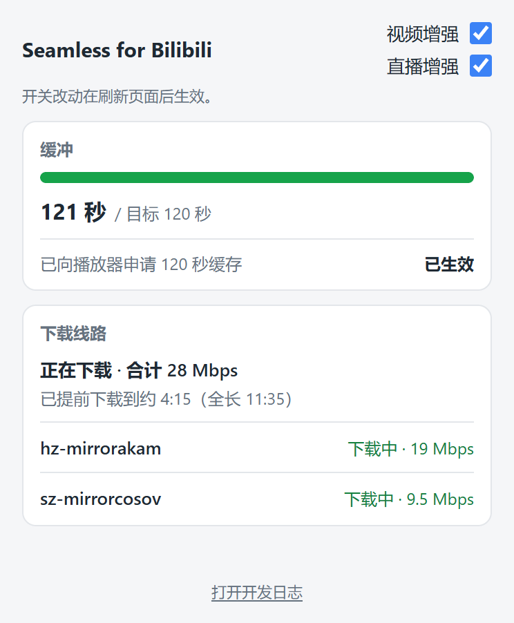

# Seamless for Bilibili

Seamless for Bilibili is a Chrome extension that reduces playback stutter on Bilibili video and live pages. It is an independent third-party tool, not affiliated with or endorsed by Bilibili; Bilibili and related names belong to their respective owners.

[简体中文](README.md) | **English** (this file)

The user-facing part of this file is complete in English. The authoritative technical specification (the download layer, panel behaviour, and background-tab behaviour) lives in Chinese in [README.md](README.md); this file gives an English overview and links to it, so every fact has one home.

Long-term product constraints: [GOAL.md](GOAL.md). Privacy policy (bilingual): [PRIVACY.md](PRIVACY.md). Changelog (bilingual): [CHANGELOG.md](CHANGELOG.md). Store listing materials: [store/README.md](store/README.md).

## What it is and who it is for

If you watch Bilibili from outside mainland China and its video or live streams stutter while your own connection tests fine, this extension is built for that situation. It takes over the player's media downloads: the same content is downloaded at the same time from the two mirror addresses that Bilibili itself provides, and whichever arrives first is used; on fMP4 live streams the same segment is also rebuilt byte for byte from the room's FLV route and raced alongside; on video pages it also asks the native player to keep a 120-second buffer. Both video and live are supported. On video, playback stays smooth at 1080p with 2× playback speed: at 2× the player consumes data twice as fast, so the headroom of assumption 3 is counted against twice the bitrate.

It does not take over playback. Play, pause, seeking, playback speed, quality, volume, and track selection remain yours and Bilibili's; the extension never rewrites or substitutes any Bilibili address.

## Assumptions, and what it does not fix

The design rests on three assumptions:

1. Stutter often comes from an individual Bilibili CDN host being slow or unstable, not from the viewer's own connection;
2. Bilibili's own playback info (playurl) already lists primary and backup mirror addresses for the same content;
3. Your bandwidth is above the video bitrate, with headroom to download two copies at once.

It fixes the slow host, not the slow link: if your home connection itself is too narrow, the buffer keeps shrinking and the stall eventually comes anyway; the extension cannot prevent that. Stalls caused by the browser's decode side (buffer still full while playback freezes, for example hardware decode starving) are also outside its reach.

The two live legs are not two independent servers in practice: measured on Windows with Chrome 154 in room 7734200, the two mirror addresses resolve to the same IP pair behind one wildcard certificate (`*.bilivideo.com`), and for long stretches Chrome pools both legs into one HTTP/2 connection; the 152 raced segment pairs agreed within 0.11 ms of each other (matching the 0.2 ms median over 235 pairs in daily usage, against about 98 ms between video mirrors). Two-leg live racing is redundancy and byte checking on one server, not failover to a second one. The FLV backup of fMP4 rooms is the failover to other servers: the same room's FLV route is served by another server group (measured: FLV on gotcha07/07b, segments on gotcha207/207b), the extension rebuilds each segment byte for byte from FLV frames, and the player gets a rebuilt segment only when its byte length and CRC32 equal the values the playlist publishes. The HEVC FLV address of the 超清 tier was measured to carry audio only; such streams have no FLV backup.

Some live pages mount the player inside an iframe that the extension's page scripts do not enter (seen on an event room's special-broadcast layout): there the takeover cannot reach the player, nothing is taken over or raced, and the popup shows its honest "not taken over" state.

About ten seconds after a tab goes to the background, Chrome stops video decoding and keeps only audio. That is the browser's power-saving behaviour; the extension neither changes it nor works around it (see the FAQ).

## How it works

**Video pages** (`/video/*`, `/list/watchlater`, and `/list/watchlater/*`, plus their language-prefixed forms `/<language>/video/*`, `/<language>/list/watchlater`, and `/<language>/list/watchlater/*`, all sharing the same video enhancement): the extension intercepts the player's media-segment requests on both interception channels (`fetch` and XHR). Each 1 MiB segment is requested from both mirror addresses Bilibili provides at once; the first complete response is stored in memory and served to the player, the losing leg is cancelled. Prefetch runs ahead (a window of up to 48 segments, 4 concurrent). Segments live only in memory (up to 512 MiB per tab) and are released when you leave the video route or close the page; nothing is written to disk. Each time a new player or media item appears, the extension asks the native player once for a 120-second stable buffer.

**Live pages** (live.bilibili.com): the extension takes over the player's FLV live stream and the player's HLS live segments (`.m4s` and `.ts`, including init segments; `.m3u8` playlists pass through to the player untouched). Addresses are paired only as the same-cluster primary/backup pair Bilibili itself supplies (for example 07 with 07b); nothing is synthesized or guessed. For an FLV stream the beginnings of both legs are compared byte-for-byte before racing delivery; for HLS the first raced segment pair is compared in full, and once the two hosts are shown to serve identical bytes every segment is downloaded from both at once, the first complete response goes to the player, and the losing leg is cancelled. If no pair is found or the comparison disagrees, it falls back to a single-leg takeover of the address the player named. fMP4 segments get a third racer: when the address book lists an FLV address with the same stream name and codec, the extension opens one FLV connection of its own and keeps about 30 s of frames in memory; the first segment that arrives over the network calibrates the rebuild, after which every segment is rebuilt from those frames and races only if its byte length and CRC32 equal the playlist's values; a rebuilt segment that fails the check is discarded, never delivered. Live gets no prefetch and no buffer target.

On both page types, download-layer failures are reported explicitly rather than silently falling back to the player's own download. The authoritative behaviour spec (in Chinese) is the [download-layer section of README.md](README.md#下载层); product constraints are in [GOAL.md](GOAL.md).

## The cost: traffic comes first

Judge this against your data plan before installing:

- **Video racing waste**: bytes already downloaded by the losing leg are discarded. One measured run settled at about 12.6% steady-state waste (it varies per session; the CDN racing panel on the logs page shows the actual rate for the current session).
- **Live traffic**: on an FLV stream both legs download continuously while paired, so traffic approaches twice the single-leg amount; on HLS without the FLV backup the racing is settled per segment, measured at about 28% waste in one real run (11 minutes, 668 segments), i.e. about 1.3 times the single-leg traffic. On fMP4 rooms with the FLV backup the extension also downloads one full FLV stream. That stream usually runs ahead of the segments the playlist publishes, so the rebuild delivers most segments first and the network legs are cancelled early: measured in four rooms (1.5 to 11 minutes), total traffic was 1.03 to 1.15 times a single stream. If the rebuild keeps losing, the network racing cost comes back on top of the FLV stream (about 2.3 times by the measurements above).
- **Downloaded ahead**: the 120-second buffer target and prefetch fetch data you have not watched yet; leave the video early and those bytes were spent for nothing.
- **Memory**: the per-tab media cache holds up to about 512 MiB.
- **Disk**: the local diagnostic log keeps only the last 3 days (72 hours); older records are deleted automatically. Measured on the developer's own browser, an open video page adds about 7 MB per hour, so disk use is roughly bounded by the last 3 days of usage; uninstalling the extension deletes all of it.
- **Switches**: the popup carries two switches, both effective after a page reload. "视频增强" (video enhancement) applies to video pages only and "直播增强" (live enhancement) to live pages only. If you do not want live's double traffic, turn off the live switch; video enhancement is unaffected.



## The popup

The popup is read-only: it shows observed facts, affects no playback, and uploads nothing. Two always-visible switches sit at the top (effective after a page reload): "视频增强" for video pages and "直播增强" for live pages, each independent of the other.

- **Buffer**: a bar and the line "已缓冲 N 秒 / 目标 120 秒" (N seconds buffered / 120-second target). The number is the continuous playable forward range covering the current playhead, not the whole video's buffer; the bar turns green when the 120-second target is reached.
- **120-second request state**: the result of asking the player for the 120-second buffer, one of 已生效 (applied) / 等待生效 (waiting) / 播放器不支持 (player does not support it) / 申请失败 (request failed). With the video enhancement switch off (effective after a page reload) no request exists: the line reads 视频增强开关：已关闭 (video enhancement switch: off), the bar drops the 120-second goal marker, and the buffered number stays the player's own measured buffer.
- **Download lines**: this card reports what the download is doing right now. The first line is a single conclusion, one at a time: 「正在下载 · 合计 X Mbps」 (downloading, X Mbps in total) while bytes are flowing, or a plain note when no data arrived in the last 5 seconds; when the player is not paused and not finished but cannot advance (`readyState` below 3), the card separates two causes, because Chromium lowers `readyState` and fires `waiting` for missing data and for a decoder that does not hand over the next frame in time alike ([whatwg/html#6359](https://github.com/whatwg/html/issues/6359)), and tells them apart by the forward buffer (`forwardSeconds`) of the same reading: with under 2 seconds buffered ahead it reads 「正在等 m:ss 处的数据」 (waiting for the data at m:ss), followed by 「，已重试 N 轮」 (, N retry rounds so far) when the missing block has failed retries, and shows no second line; with 2 seconds or more buffered it reads 「播放器解码没跟上，缓冲里还有 N 秒数据」 (the player's decoder is not keeping up; N seconds of data are still buffered, N being a whole number like the buffer bar's seconds) and the popup hints that on some computers these stalls stop after turning off "Use graphics acceleration when available" in Chrome Settings › System and restarting Chrome; the second line shows download progress as usual when there are download records; 「已下载够，暂停下载」 (enough downloaded, paused) when the download has run far enough ahead and stopped by design; and a plain 「还没有下载数据」 (no download data yet) before the first download record when there is no decoder stall. The decoder line takes priority even without download records. The second line on video pages, shown when download records exist except while the player waits for missing data, says how far ahead the download reached, 「已提前下载到约 m:ss（全长 m:ss）」 (downloaded ahead to about m:ss of the m:ss total), and says so when the whole video is already in. Live pages have no second line: a live stream has no fixed position. Below, each CDN mirror line this playback actually used (usually two) gets one row with that line's own state: 「下载中 · X Mbps」 (downloading at X Mbps), 「空闲」 (idle), 「另一条线路更快」 (the other line was faster), or a failure reason such as 「10 秒没有收到数据」 (no data for 10 seconds). The connection times and the cumulative stall and error counts no longer appear on the popup; their history stays on the CDN racing panel of the logs page.
- **Live pages** use the same layout: the same download-lines card plus one live-takeover line (正在按两条线路竞速下载 racing on two lines / 单路接管（无可用备用线路） single leg, no backup found / 接管请求失败 takeover request failed / 未接管（未发现直播媒体流） not taken over, no live media stream found / 等待直播数据 waiting for live data). On fMP4 rooms the line continues with the FLV backup state (FLV 后备校准中 calibrating / FLV 后备已接上 ready / FLV 后备重连中 reconnecting / FLV 后备已断开 gave up / 无 FLV 后备 no FLV backup). With the live enhancement switch off (effective after a page reload) the takeover never engages and the line says so (直播增强开关已关闭, live enhancement switch: off) instead of waiting for data forever. Live has no buffer bar.
- **When a live stream stalls**, the first line and the line rows say what the extension is waiting for instead of reading 「空闲」 (idle) throughout. The first of these rows that holds applies, in this order. A segment request of the current stream in flight for 2 seconds or more reads 「在等一个分片，已 N 秒没收到数据」 (waiting for a segment, no data for N seconds; the line rows of the legs in flight read 「等待中 N 秒」, waiting N seconds) or, once some bytes arrived, 「分片下载中，已 N 秒，收到 X KB」 (segment downloading, N seconds so far, X KB received, written in bytes below 1 KB, in KB below 1 MB, and in MB with one decimal above; lines that received bytes read 「下载中 · 已收到 X KB」, the rest 「等待中 N 秒」). With no request in flight, a playlist that still refreshes but has added no segment for 3 seconds or more (`noticeMs`) reads 「播放列表 N 秒没有新分片」 (playlist has no new segment for N seconds), followed by 「，FLV 后备也没有新画面」 (, the FLV backup has no new frames either) when the FLV connection has also been silent for 3 seconds or more; a playlist that has not been refreshed for 3 seconds or more reads 「播放器 N 秒没有请求数据」 (the player has requested no data for N seconds). In both of those the line rows read 「空闲」. When none of these rows holds, the usual wording stands (「正在下载 · 合计 X Mbps」, or 「最近 5 秒没有收到数据」). These rows rest on a valid snapshot (see "Live stall snapshots" below) and apply even before any leg has finished (the very first segment hangs), where the card would otherwise read 「还没有下载数据」. After a stream change the requests of the old and the new stream can be in flight together; the player waits for the current stream's (the stream of the latest segment request), so only that stream counts, and with several requests in flight on it the one that has waited longest. Finished lines gain two live-page texts: 「播放器已取消」 (the player cancelled the request; video pages still read 「空闲」) and 「FLV 里没有这段画面」 (the FLV has no frames for this segment). The popup states only what the extension observed. A playlist that stopped while the FLV backup also has no new frames usually means the streamer or the origin stopped (both server groups go quiet at once); but an edge node stuck on its upstream stalls the playlist too while the FLV servers stay healthy, and then the first line stops at 「播放列表 N 秒没有新分片」 without the FLV suffix, so the popup does not draw the "streamer or origin stopped" conclusion. A page in a background tab can also stop requesting and then reads 「播放器 N 秒没有请求数据」: that says the player requested nothing, not that the stream broke. Rooms where the player pulls a single long FLV connection have no segment requests and no snapshot; their display does not change, and the video page's `bank.inventory` is untouched.
- The popup only reports the active tab of the window it belongs to; another window's page is never shown. On a page that is not playing (or not a Bilibili page at all), the cards fold away and a single friendly hint remains. A Bilibili page that was already open when the extension was installed or updated has no live content script to answer (an update orphans the old page's scripts), and the popup cannot tell that case from a non-Bilibili page without new permissions; the single hint therefore covers both cases with one reload path. An update orphans only the old context and its log persistence: the download layer runs in the page's main world and keeps serving, so measured playback continues unaffected, cached video chunks drawing zero new network requests and live rooms keeping both mirrors racing with no segment pull falling back to the native path, until the page is reloaded once and the new build attaches.



## Install

**Chrome Web Store**: the release is in preparation; the store link will be placed here once live. Until then, do not trust any installation page claiming to be this extension.

**Load unpacked from source**: requires Node.js 20+ and Chrome/Chromium 120+.

```sh
npm ci
npm run build
```

Enable developer mode in `chrome://extensions` and load `dist/extension`. The repo commits a directly loadable `dist/extension`; after changing source, rebuild, click "Reload" on the extensions page, and refresh open Bilibili pages.

## Privacy

Data never leaves the device: media segments only transit through memory, the diagnostic log stays in the extension's own local database, and there is no upload, telemetry, or any external endpoint. The extension requests only `storage` and `unlimitedStorage` (no `tabs`, no `downloads`, no host permissions). Full policy: [PRIVACY.md](PRIVACY.md) (bilingual).

## FAQ

**Will this always remove stutter?**
No. It targets the "one slow CDN host" class of stutter; a narrow home connection or a browser that cannot decode fast enough is beyond it (see [assumptions](#assumptions-and-what-it-does-not-fix)).

**Why does a background tab keep playing audio while the picture freezes?**
Chrome stops video decoding for background tabs (background video track optimization). When you switch back, the page itself rebuilds the player: the frame counter restarts from zero and the buffer collapses and refills. This is browser behaviour; the extension does not change it or work around it. Details in the [background-tab section of README.md](README.md#浏览器后台行为) (Chinese).

**The buffer bar never reaches 120 seconds?**
That means the connection cannot keep up with the current bitrate. The extension spends the available bandwidth on what the player actually needs; it cannot keep a buffer from draining on a slow link.

**Can live be switched off separately?**
Yes. The "直播增强" (live enhancement) switch in the popup controls live pages only (it takes effect after a page reload): with it off, the player downloads natively (no takeover, no racing) and video enhancement is unaffected.

**Does it touch playback controls?**
No. Play, pause, seeking, speed, quality, volume, and tracks stay with you and the player; the popup is read-only.

**What gets uploaded?**
Nothing. See [PRIVACY.md](PRIVACY.md).

## Feedback

Issues and suggestions: https://github.com/chnlich/seamless-for-bilibili/issues

## License

[MIT](LICENSE).

---

## Technical overview (English)

The sections below describe how the implementation works. The full authoritative spec (exact interception rules, event names, and edge cases) is the Chinese [下载层 section of README.md](README.md#下载层); where this overview and that spec could ever disagree, that spec wins.

- **Interception.** The extension runs inside the page's own JavaScript context and wraps `fetch` and `XMLHttpRequest` (two parallel interception channels with identical behaviour). On video pages, a media request has a host ending in `.bilivideo.com` or `.akamaized.net`, or a path matching an audio/video address in Bilibili's playback info (the playurl address book). This includes listed PCDN nodes such as `*.mcdn.bilivideo.cn:8082` and `*.edge.mountaintoys.cn:4483`. If neither rule matches and the request carries a closed single Range, the bank reads inline `__playinfo__` once and classifies again; requests without a closed Range do not trigger that read. Recognized requests with a closed single Range are intercepted. Cache hits are answered from memory; a miss fetches the complete chunks covering the requested range, stores them, and answers the player's original Range. Non-media requests, missing or non-closed Ranges, synchronous XHR, live `.m3u8` playlists (`live_hls_playlist`), other unrecognized live media (`live_other_media`), and `internal_fallback`/`internal_error` paths pass through. `bank.serve` records `pass` and the reason; `non_media_host` means neither a known host suffix nor an address-book path matched. Hits record `mirror` and `durationMs`. Both legs of a `bank.fetch.chunk` race use the player's address without query parameters as `source`; each leg's `mirror` is its actual host, so different-path legs still form one race in the CDN panel. The player never issues a network request for an intercepted segment itself.
- **Video pairing.** When a pair is available, each chunk races the player's address and a second address for the same representation (`raceLegs=2`). The player's requested path selects the address-book entry. A second address must use a different host; known Bilibili CDN suffixes take priority, otherwise the first different-host address in list order is used. Paths may differ between legs. Each URL is requested verbatim with its own signature, preserving the supplied paths, hosts, and signatures. The first complete response is stored and served; bytes already read by the losing leg are the racing cost. The address book comes from network playurl responses, with inline `window.__playinfo__` read on demand when no pair is available.
- **Video buffering.** The extension never builds a playback pipeline. It uses Bilibili's own player API to ask for a 120-second stable buffer, once per player or media item, and shows the player-reported forward range in the popup.
- **Live takeover.** On live pages the extension answers the player's FLV stream requests and HLS media-segment requests directly. Mirror pairing comes from Bilibili's own live playback info (the page-embedded `playurl_info` and the player's `getRoomPlayInfo` traffic); only same-cluster primary/backup pairs are raced. On FLV, byte windows are compared between legs (1 MiB windows); on HLS, the first raced segment pair is compared in full, and the paired segment URL reuses the paired address-book entry's own host and signed query over the player's stream path and segment name. Any disagreement permanently degrades that stream to the single address the player named. Both legs dying, or an expired signature with no new address, fails explicitly, with no silent native fallback. On fMP4 streams a third leg (slot 2) rebuilds each segment from the room's same-name, same-codec FLV stream: the extension reads the playlists the player receives on both channels for each segment's `#EXT-BILI-AUX` byte length and CRC32, calibrates on the first network segment, and offers a rebuilt segment only when both match; the FLV connection reconnects at most 3 times before giving up with a full-rate error, and it closes on stream change, page leave, or with the switch off (then it never opens). Events: `live.flv.backup`, slot-2 `bank.fetch.chunk`, and `winner` on `bank.serve` hits.
- **FLV rebuild calibration.** The first network-delivered segment with AUX values calibrates the rebuild. Changed init-segment bytes trigger recalibration; a renamed init with identical bytes preserves calibration. An FLV reconnect invalidates both the frame window and calibration, and the next network segment calibrates again. Once calibrated, each network-delivered segment is first rebuilt with the current anchor. A `verified` result or `waiting` for frames preserves that anchor. A `mismatch` or `frames_missing` result triggers recalibration from that segment's own bytes and AUX values. Success replaces the anchor and retries pending rebuilds with it; failure keeps the old anchor and does not count toward the calibration-failure limit. A successful replacement records `live.flv.backup` with state `calibrated`, reason `reanchored`, and `offsetChangeMs`: the change in HLS-minus-FLV time offset, in milliseconds, equal to the dropped FLV span. Byte length and CRC32 must still match before any rebuilt segment is delivered.
- **Live stall snapshots.** While a stall sign holds on an HLS live page, the page writes a `live.inventory` event every 2 seconds (`snapshotIntervalMs`); normal playback writes none, and the event only observes (downloading, racing and stitching are unchanged). The stall sign is a segment request in flight for 2 seconds or more (`stallSignMs`), or 2 seconds since the last delivery, counted from the first playlist response or segment request (not from page load) when nothing was delivered yet; a page whose player pulls one long FLV connection has no such signal and writes nothing. The check runs every 250 ms (`tickMs`), so the first snapshot comes at most 250 ms late and two snapshots lie at most 250 ms more than 2 seconds apart; the newest snapshot is therefore always inside the 3-second validity window (`validMs`) when the popup reads the log. When the stall sign no longer holds (a delivery, and no other request in flight for 2 seconds or more), a series that wrote a snapshot ends with one closing snapshot with `delivered: true`; a player that requests and receives later segments while one segment hangs does not end the series, which runs on until the hanging request is delivered or ends. Segments about a second apart never raise the sign; a room whose segments are occasionally 2 seconds apart writes a snapshot and a closing snapshot at such a moment, which affects nothing. Nothing is written while the live enhancement switch is off, and switching it on again does not count the time spent off as time without a delivery. The event's fields are `streamPath` (the stream of the latest segment request; before any request has started, the stream of a playlist response), `delivered`, `inflight`, `playlistResponseAgeMs` (since the stream's last playlist response), `playlistNewSegmentAgeMs` (since its playlist last listed a segment name not seen before) and `flvFrameAgeMs` (since its FLV connection last received a video frame). `inflight` holds one entry per in-flight segment request: `streamPath`, `ageMs` and `legs`, each leg with `slot` (0 and 1 are the network legs, 2 is the FLV rebuild leg, whose `bytes` stay 0 until the segment is rebuilt), `mirror` (host name), `bytes` and `lastByteAgeMs`. A value the download layer does not have is `null` rather than a default (a leg that has received no byte yet, a stream without a playlist response yet, no FLV backup), and every age is relative to the event's own `wallTime`; page and background worker share one machine and one clock, so the popup only adds the elapsed time. The top-level field names are registered in `DATA_ALLOWLIST.liveInventory` (`src/diagnostics/catalog.js`); `src/diagnostics/privacy.js` checks the fields inside `inflight` one by one (paths lose their query, numbers must be non-negative integers, a malformed structure raises an error instead of being dropped). The background worker hands the newest snapshot to the popup together with the download records (`readCdnSummary` in `src/diagnostics/worker.js`, `src/diagnostics/download-status.js`): the snapshot rows apply only while it is under 3 seconds old when the log is read and is not a `delivered` closing snapshot, and the seconds shown add the time since the snapshot was written. Intervals and thresholds are the named constants `LIVE_INVENTORY_CONFIG` in `src/constants.js`; the page side is `src/bank/live-inventory.js`, the wording is `liveWaitOf` in `src/extension/popup-view.js`. `scripts/live-backup-run.mjs --hold-flv` (which needs `--delay-every`) holds the FLV connection as well as the network legs, so that every leg of a held segment waits: from the start of holding, no FLV response bytes reach the page (the connection stays open and the backup sees a stall), and segments are held 12 s later (`FLV_HOLD_LEAD_MS`), so that the connection stalled for 10 s is dropped together with the frame window the rebuild leg uses; the backup then disconnects in its reconnect loop and gives up, visible in the report. `--popup-captures <dir>` photographs the real toolbar popup once in the normal phase and once for each of the first two held segments (`--delay-ms` of at least 6000), writing `<phase>.png` and `<phase>.json` (the readouts of the first line, the takeover line and the line rows) into the directory. The report adds `live.inventory` statistics: the counts before and after holding starts (0 in the normal phase), the gaps between consecutive snapshots of one stall, and the number of closing snapshots written after a delivery.
- **Bounds.** Segments live in a `Map` capped at 512 MiB per tab and are never written to disk; a fetch that receives no bytes for 10 s is cancelled and its partial chunk discarded; the prefetch window covers at most 48 chunks with 4 concurrent fetches and at most 3 consecutive failures per chunk.
- **Diagnostics.** A structured local-only log records page routes, media facts, and download-layer events; it keeps the last 3 days (72 hours) and deletes older records automatically, by each record's own time. The logs page states this retention. An export fixes its maxEventId snapshot when it starts; rows pruned out of that range while the export runs are skipped by the pagination and the export still completes. The logs page also includes a CDN racing panel with per-mirror racing, stall, latency, and waste statistics; the panel aggregates one session at a time (the session the popup's log-page link carries), and the read button stays disabled with an explicit entry hint when no session is selectable. The popup shows a deliberately small subset (buffer, the current download state with one row per mirror line, live takeover state, including an explicit "not taken over" state when the player streams outside the taken-over formats, instead of implying a takeover that never engaged).

Video and live pages record the same passive `media.*` events, including the per-frame-period `frameTiming` aggregate. Live observation runs independently of the live enhancement switch; it only listens to the player and never changes playback. These detailed media facts stay on the logs page rather than the popup.

Build, test, and verification commands are identical on any OS and are listed in the [build section of README.md](README.md#构建) and the [testing section of README.md](README.md#测试与验证) (both Chinese). The repo carries no device-specific paths.
